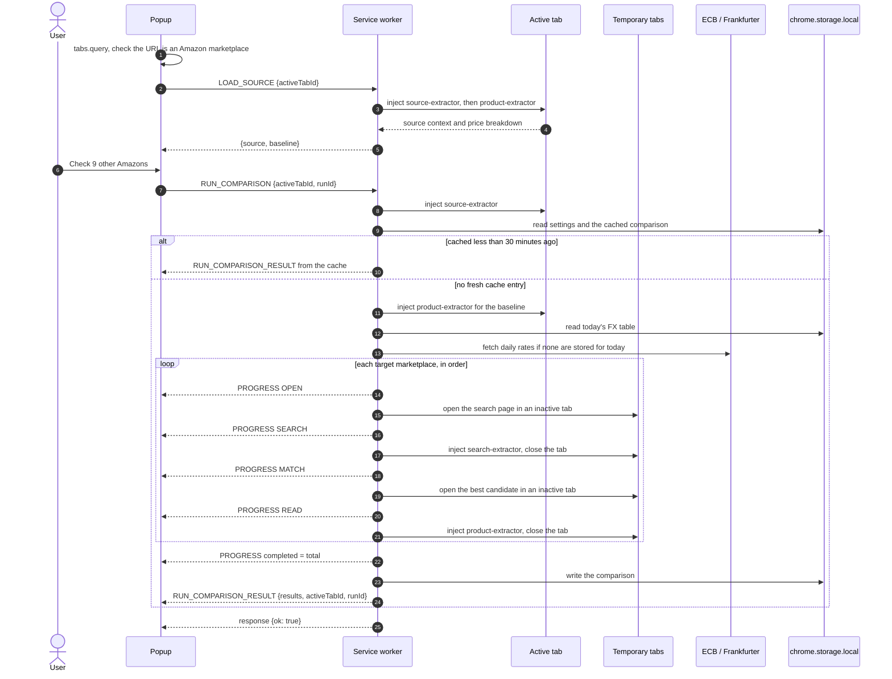

# Architecture

Across Amazon is a Manifest V3 extension with four parts:

- **Popup** (`popup.html`, `src/popup`): a React app that shows one comparison for the active tab.
- **Background service worker** (`src/background`): runs comparisons, owns the temporary tabs, fetches exchange rates and caches results.
- **Content scripts** (`src/content`): small extractors injected on demand into Amazon pages with `chrome.scripting.executeScript`. None is declared in the manifest, so nothing runs on a page until a comparison asks for it.
- **Options page** (`options.html`, `src/options`): the full settings form.

The manifest asks for `activeTab`, `scripting`, `storage` and `tabs`, plus host permissions for the ten Amazon domains.

## How a comparison runs

### 1. The popup opens

The popup asks `chrome.tabs.query` for the active tab. If the URL's host is not one of the ten marketplace domains, it shows "Open an Amazon product page" and sends nothing to the background.

Otherwise it sends `LOAD_SOURCE` with the tab id. The background (`loadSource` in `orchestrator.ts`) injects `content/source-extractor.js` into the tab to read the **source context**: marketplace, ASIN, title, brand, variation tokens from the selected colour, size, style and pack options, the destination country from Amazon's "Deliver to" box, and the product image. It then injects `content/product-extractor.js` into the same tab to read the **baseline**: item price, shipping and import fees on the page you are on. `LOAD_SOURCE` returns the raw baseline without fetching exchange rates, so the idle view appears quickly. If the source context cannot be read, the response carries an `error` and the popup shows the not-on-Amazon notice. If only the price cannot be read, the popup shows the product without one.

### 2. The user starts a run

Clicking the button creates a **run id** (`crypto.randomUUID()`) and sends `RUN_COMPARISON {activeTabId, runId}`. The popup switches to the running view straight away.

The background (`runComparison`) then:

1. **Registers a run token** for the tab. A token holds a `cancelled` flag and the ids of the temporary tabs the run opened. Starting a run for a tab cancels any previous token for that tab.
2. **Extracts the source context** again on the active tab and **loads the settings** (`settings:v1`). The target marketplaces are the enabled ones minus the source marketplace.
3. **Checks the cache.** The key (`cmp:<hash>`) is built from the ASIN, variation tokens, source marketplace, destination country and target marketplaces. A record younger than 30 minutes is returned as the result immediately, with no progress messages and no tabs.
4. **Extracts the baseline** on the active tab. Missing shipping or import fees on the page you are on count as zero.
5. **Fetches the FX table** (`fx-service.ts`). The table is stored per UTC day as `fx:YYYY-MM-DD`. When today's table is missing, the worker fetches the ECB daily reference rates XML and falls back to the Frankfurter API. If both fail the run ends with an error.
6. **Checks each target marketplace in turn**, one at a time:
   - **OPEN**: opens `https://<domain>/s?k=<title brand variant>` in an inactive tab and waits up to 15 seconds for it to finish loading.
   - **SEARCH**: injects `content/search-extractor.js`, reads up to eight result cards, and closes the tab.
   - **MATCH**: scores every candidate against the source (`shared/matching.ts`): title token similarity 45%, brand 25%, variation tokens 30%. The best candidate must score at least 0.78, otherwise the marketplace becomes `NO_CONFIDENT_MATCH`. The best candidate's product page is opened in another inactive tab.
   - **READ**: injects `content/product-extractor.js` with the source destination country, reads the cost stack and closes the tab. The result is `DESTINATION_MISMATCH` when the page ships to a different country, `UNAVAILABLE` when the item price, shipping or import information is missing, and `OK` otherwise. Its confidence is 80% match score plus 20% parse confidence. An extractor that returns nothing, or any thrown error (timeout, closed tab, script failure), becomes `PARSE_FAILED` for that marketplace only.

   Entering each phase sends `RUN_COMPARISON_PROGRESS` with `completed`, `total`, `currentMarketplace`, `phase`, the **partial ranking** of the results so far, and the FX table. The popup uses these to draw the dial and the chips.
7. **Normalizes** each `OK` result: the delivered total (item + shipping + import fees in the marketplace currency, or Amazon's displayed total when it is higher) is converted to the comparison currency. A result that cannot be totalled or converted becomes `UNAVAILABLE`.
8. Sends a final progress message with `completed = total`, **writes the cache record**, and returns the payload: source, baseline, sorted results, `generatedAt`, FX table, `activeTabId` and `runId`.
9. **Closes any temporary tabs** that are still open, whatever the outcome.

The service worker (`service-worker.ts`) sends the payload as `RUN_COMPARISON_RESULT` and only then answers the original `RUN_COMPARISON` message with `{ok: true}`. If the popup gets no `ok` answer (the background could not be reached), it ends the run with "Could not reach the background service".

The popup ranks and labels results itself (`src/popup/view-model.ts`). It converts every delivered total to the display currency from the result's own breakdown and the FX table, so changing the display currency never needs a new run.

### Cancellation

**Stop checking** sends `CANCEL_COMPARISON {activeTabId}`. The background marks that tab's token as cancelled and closes its temporary tabs at once. The run notices at its next phase or when the current marketplace finishes, throws "Comparison cancelled by user", and finishes with an error payload that the popup ignores because it has already returned to idle. Each run has its own token, so a run started right after Stop cannot un-cancel the previous one.

### Message correlation

Progress and result messages are broadcast with `chrome.runtime.sendMessage`, so every open extension page receives every message. Each one carries the `activeTabId` and `runId` from the request, and the popup's reducer (`belongsToRun` in `App.tsx`) only accepts a message when:

- its `activeTabId` matches the popup's tab, so a comparison running for another tab or window never shows up, and
- while a run is active, its `runId` matches the run this popup started, so late messages from a stopped or replaced run are dropped.

After a run finishes or is cancelled, further messages for it are ignored. Before the popup has started a run, it accepts progress for its own tab. That is how a reopened popup picks up a run that is still going.

### Why content scripts are IIFE-wrapped

`chrome.scripting.executeScript({ files })` runs a file as a classic script in the page's isolated world, and that world persists between injections. The same tab is injected several times: the source and product extractors run on the active tab for `LOAD_SOURCE` and again for every `RUN_COMPARISON`. A bundled file with top-level `const` or `let` bindings throws `Identifier '…' has already been declared` on the second injection.

The `isolateContentScripts` plugin in `vite.config.ts` wraps every chunk under `content/` in `(() => { … })();` at build time and shifts its source map by one line. It also fails the build if a content chunk imports or exports anything, because a classic script cannot. `tests/unit/build.test.ts` builds the extension and evaluates each extractor twice in the same JSDOM isolated world to prove it.

The background and the extractors exchange data through window properties in the isolated world: the worker writes a request such as `__ACROSS_AMAZON_SEARCH_REQUEST__`, injects the extractor file, then reads and deletes the result property (for example `__ACROSS_AMAZON_SEARCH_CANDIDATES__`).

## Storage

Everything lives in `chrome.storage.local`:

| Key | Contents | Lifetime |
| --- | --- | --- |
| `settings:v1` | Enabled marketplaces, comparison currency (`SOURCE` or a currency code), disclosure flag | Until changed |
| `cmp:<hash>` | Source, baseline, ranked results and FX table of a finished run | Reused for 30 minutes, deleted when read after that |
| `fx:YYYY-MM-DD` | The FX table for a UTC day | Reused for that day |

## Module map

| Path | Responsibility |
| --- | --- |
| `src/background/service-worker.ts` | Message router for `RUN_COMPARISON`, `LOAD_SOURCE` and `CANCEL_COMPARISON`; sends the result message. |
| `src/background/orchestrator.ts` | Run tokens, temporary tabs, script injection, the OPEN/SEARCH/MATCH/READ loop, normalization, caching and progress. |
| `src/background/fx-service.ts` | Daily FX table: storage per UTC day, ECB XML first, Frankfurter as a fallback. |
| `src/content/source-extractor.ts` | Reads the source context from the active product page. |
| `src/content/search-extractor.ts` | Reads search result cards (ASIN, title, brand, price, URL). |
| `src/content/product-extractor.ts` | Reads item price, shipping, import fees, displayed total, destination and deliverability from a product page. |
| `src/shared/types.ts` | Shared data types (`SourceContext`, `ComparisonResult`, payloads, settings). |
| `src/shared/messages.ts` | Message type constants, request shapes and type guards. |
| `src/shared/markets.ts` | The ten marketplaces: domain, currency, locale, flag; search URLs. |
| `src/shared/matching.ts` | Title, brand and variant scoring and the match threshold. |
| `src/shared/money.ts` | Localized price parsing, delivered totals, currency conversion and formatting. |
| `src/shared/comparison.ts` | Result ordering: comparable results by normalized total, then the rest. |
| `src/shared/storage.ts` | Settings and comparison cache access. |
| `src/popup/App.tsx` | Popup state reducer, chrome messaging and run correlation. |
| `src/popup/view-model.ts` | Pure ranking, verdict, deltas and user-facing copy. |
| `src/popup/components/` | Views: top bar, idle, running, done (verdict card, ranked list, issues), detail sheet, settings, footer, toast. |
| `src/options/` | Options page: marketplaces, comparison currency (including CAD, MXN and AUD), disclosure, explicit save. |
| `vite.config.ts` | Multi-entry build (popup, options, service worker, three content scripts) and the IIFE plugin. |
| `manifest.json` | Copied into `dist/` by `pnpm build`. |

See [Testing](testing.md) for how each layer is tested.
