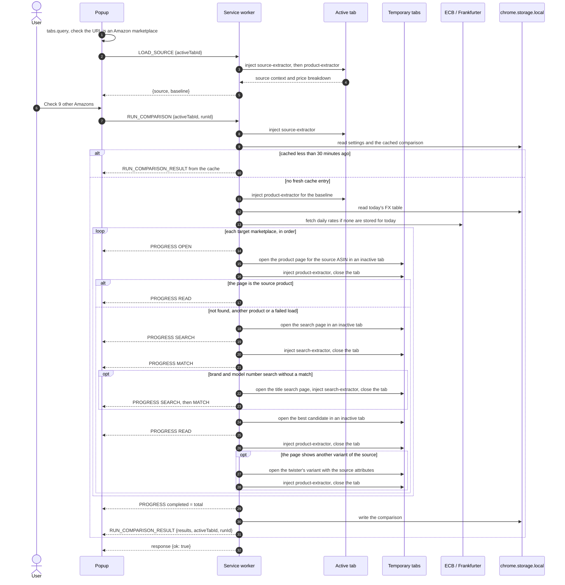

# Architecture

Across Amazon is a Manifest V3 extension with four parts:

- **Popup** (`popup.html`, `src/popup`): a React app that shows one comparison for the active tab.
- **Background service worker** (`src/background`): runs comparisons, owns the temporary tabs, fetches exchange rates and caches results.
- **Content scripts** (`src/content`): small extractors injected on demand into Amazon pages with `chrome.scripting.executeScript`. None is declared in the manifest, so nothing runs on a page until a comparison asks for it.
- **Options page** (`options.html`, `src/options`): the full settings form.

The manifest asks for `activeTab`, `scripting`, `storage` and `tabs`, plus host permissions for the ten Amazon domains and the two exchange rate hosts, `www.ecb.europa.eu` and `api.frankfurter.dev`.

## How a comparison runs

### 1. The popup opens

The popup asks `chrome.tabs.query` for the active tab. If the URL's host is not one of the ten marketplace domains, it shows "Open an Amazon product page" and sends nothing to the background.

Otherwise it sends `LOAD_SOURCE` with the tab id. The background (`loadSource` in `orchestrator.ts`) injects `content/source-extractor.js` into the tab to read the **source context**: marketplace, ASIN, title, brand (from the brand row of the product overview, else the store byline), variation tokens from the selected colour, size, style and pack options, the destination country and the text of Amazon's "Deliver to" box, and the product image. It then injects `content/product-extractor.js` into the same tab to read the **baseline**: item price, shipping and import fees on the page you are on. `LOAD_SOURCE` returns the raw baseline without fetching exchange rates, so the idle view appears quickly. If the source context cannot be read, the response carries an `error` and the popup shows the not-on-Amazon notice. If only the price cannot be read, the popup shows the product without one.

### 2. The user starts a run

Clicking the button creates a **run id** (`crypto.randomUUID()`) and sends `RUN_COMPARISON {activeTabId, runId}`. The popup switches to the running view straight away.

The background (`runComparison`) then:

1. **Registers a run token** for the tab. A token holds a `cancelled` flag and the ids of the temporary tabs the run opened. Starting a run for a tab cancels any previous token for that tab.
2. **Extracts the source context** again on the active tab and **loads the settings** (`settings:v1`). The target marketplaces are the enabled ones minus the source marketplace.
3. **Checks the cache.** The key (`cmp:<hash>`) is built from a cache version, the ASIN, variation tokens, source marketplace, destination country, the source page's "Deliver to" text and target marketplaces. The text keeps two addresses apart that resolve to the same country code, such as "Deliver to Switzerland" (not recognised, so it falls back to the marketplace's country) and a US town and ZIP code. A record younger than 30 minutes is returned as the result immediately, with no progress messages and no tabs. The version changes when extraction or matching changes, so a result cached by an earlier build is never shown.
4. **Extracts the baseline** on the active tab. Missing shipping or import fees on the page you are on count as zero.
5. **Fetches the FX table** (`fx-service.ts`). The table is stored per UTC day as `fx:YYYY-MM-DD`. When today's table is missing, the worker fetches the ECB daily reference rates XML and falls back to the Frankfurter API (`api.frankfurter.dev/v1/latest`). Both rate hosts are host permissions: the ECB feed sends no CORS headers, and listing Frankfurter keeps the fallback independent of its CORS headers. If both fail the run ends with an error.
6. **Checks each target marketplace in turn**, one at a time:
   - **OPEN**: opens `https://<domain>/dp/<source ASIN>` in an inactive tab, waits up to 15 seconds for it to finish loading, reads it with `content/product-extractor.js` and closes it. The page is the source product when its own ASIN field or canonical link names the source ASIN, it has a product title, and that title shares at least one word with the source title. The marketplace is then **matched by ASIN**: it skips to READ with a match score of 1 and the note "Matched by ASIN". A not-found page, a redirect to another ASIN, an unrelated title, a load timeout, a closed tab or a script failure falls back to a **search**. When the source title carries a distinctive model number (at least five characters with two letters and two digits that is not a measurement such as `128GB`, for example `WH-1000XM5`), the worker first opens `https://<domain>/s?k=<brand model>` in another inactive tab and waits for it the same way: amazon.co.jp lists no WH-1000XM5 for the whole English title but lists it first for "Sony WH-1000XM5". When that search yields no confident match, or the title has no such model number, it searches `https://<domain>/s?k=<title brand variant>`.
   - **SEARCH** (search fallback only, once per query): injects `content/search-extractor.js`, reads up to eight organic result cards (ASIN, title, brand, price and product link, in both the current and the older card layout), and closes the tab. Sponsored cards and cards without a `/dp/` or `/gp/product/` link are skipped.
   - **MATCH** (search fallback only): scores every candidate against the source (`shared/matching.ts`). A candidate with the source ASIN and at least one title word in common scores 1. Any other candidate is scored on title token similarity 45%, brand 25% and variation 30%. Variation compares pack, size and colour tokens from the source's selected options and both titles. Brand only counts when the source page has one, and variation only when both the source and the candidate's title name one (search cards often leave the colour out of the title); the remaining weights are scaled up to 100%. A candidate without a brand gets 0.75 for brand when its title names the source brand. A candidate whose brand equals the source brand and whose title carries the source's distinctive model number scores its title at least 0.7, so a localized or reworded listing (amazon.it's "WH-1000XM5 Premium Bluetooth Headphones with Noise Cancelling", title similarity 0.545) reaches 0.8071; the lift is withheld from bundles (" & ", " + ", "bundle"), from candidates naming another colour, pack or size, and from candidates with a second model number. A candidate whose model numbers all differ from the source title's is capped at 0.5. Two model numbers are the same when they are equal once hyphens are dropped (`WH1000XM5` and `WH-1000XM5`) or when one is a bare segment of the other (`1000XM5`), so `WF-1000XM5` earbuds do not pass for `WH-1000XM5` headphones. The best candidate must score at least 0.78, otherwise the marketplace becomes `NO_CONFIDENT_MATCH`. The best candidate's product page is opened in another inactive tab.
   - **READ**: for a search match, injects `content/product-extractor.js` with the source destination country, reads the cost stack and closes the tab. A match by ASIN uses the page already read during OPEN. A search match then gets a **variant check**: the values the page's twister has selected are compared with the source's colour, pack and size tokens, each kind on its own. When a kind conflicts (a silver listing for a black source), the worker opens the variant the page's twister offers with the source's attributes, once, and reads that page instead, adding the note "Switched to the Black variant". When the twister offers no such variant, or that page still conflicts, the marketplace becomes `NO_CONFIDENT_MATCH` with the variant it found. The result is `DESTINATION_MISMATCH` when the page ships to a different country, `UNAVAILABLE` when the item price or the shipping is missing (including a page that exists but shows no price for the destination, whose notes relay Amazon's availability message), and `OK` otherwise. A page that prices the item and the delivery but shows no import fees is `OK` with a total of item plus shipping and the note "Import fees not displayed for destination": only amazon.com shows import charges for an address abroad, in its AmazonGlobal details. The page's destination is the country named in its "Deliver to" box, or named in full in its delivery message; two-letter codes count only in the box, so Spanish "de" or English "it" in a delivery message is not read as a country. When the box shows a town and a postcode in the marketplace's own format instead of a country, as Amazon does for an address at home (five digits for the US, Mexico and the EU stores, `A1A 1A1` for Canada, UK outward and inward codes, `123-4567` for Japan, four digits for Australia), the destination is the marketplace's own country, unless the source page's "Deliver to" box shows the same postcode. Its confidence is 80% match score plus 20% parse confidence, so a fully read match by ASIN has confidence 1. Its notes start with "Matched by ASIN", or "Matched by search" and the confidence label, and its link is `https://<domain>/dp/<matched ASIN>`. An extractor that returns nothing, or any thrown error after the lookup (timeout, closed tab, script failure), becomes `PARSE_FAILED` for that marketplace only.

   Entering each phase sends `RUN_COMPARISON_PROGRESS` with `completed`, `total`, `currentMarketplace`, `phase`, the **partial ranking** of the results so far, and the FX table. The popup uses these to draw the dial and the chips. A marketplace matched by ASIN reports OPEN then READ; a search fallback reports OPEN, SEARCH, MATCH and READ, with SEARCH and MATCH a second time when it also searches by title.
7. **Normalizes** each `OK` result: the delivered total (item + shipping + import fees when the page shows them, in the page's currency, or Amazon's displayed total when it is higher) is converted to the comparison currency. A result that cannot be totalled or converted becomes `UNAVAILABLE`.
8. Sends a final progress message with `completed = total`, **writes the cache record**, and returns the payload: source, baseline, sorted results, `generatedAt`, FX table, `activeTabId` and `runId`.
9. **Closes any temporary tabs** that are still open, whatever the outcome.

The service worker (`service-worker.ts`) sends the payload as `RUN_COMPARISON_RESULT` and only then answers the original `RUN_COMPARISON` message with `{ok: true}`. If the popup gets no `ok` answer (the background could not be reached), it ends the run with "Could not reach the background service".

The popup ranks and labels results itself (`src/popup/view-model.ts`). It converts every delivered total to the display currency from the result's own breakdown and the FX table, so changing the display currency never needs a new run.

### Cancellation

**Stop checking** sends `CANCEL_COMPARISON {activeTabId}`. The background marks that tab's token as cancelled and closes its temporary tabs at once, including the tab of an ASIN lookup in progress. The run notices at its next phase or when the current marketplace finishes, throws "Comparison cancelled by user", and finishes with an error payload that the popup ignores because it has already returned to idle. A lookup interrupted by Stop never falls back to a search. Each run has its own token, so a run started right after Stop cannot un-cancel the previous one.

### Message correlation

Progress and result messages are broadcast with `chrome.runtime.sendMessage`, so every open extension page receives every message. Each one carries the `activeTabId` and `runId` from the request, and the popup's reducer (`belongsToRun` in `App.tsx`) only accepts a message when:

- its `activeTabId` matches the popup's tab, so a comparison running for another tab or window never shows up, and
- while a run is active, its `runId` matches the run this popup started, so late messages from a stopped or replaced run are dropped.

After a run finishes or is cancelled, further messages for it are ignored. Before the popup has started a run, it accepts progress for its own tab. That is how a reopened popup picks up a run that is still going.

### Why content scripts are IIFE-wrapped

`chrome.scripting.executeScript({ files })` runs a file as a classic script in the page's isolated world, and that world persists between injections. The same tab is injected several times: the source and product extractors run on the active tab for `LOAD_SOURCE` and again for every `RUN_COMPARISON`. A bundled file with top-level `const` or `let` bindings throws `Identifier '…' has already been declared` on the second injection.

The `isolateContentScripts` plugin in `vite.config.ts` wraps every chunk under `content/` in `(() => { … })();` at build time and shifts its source map by one line. It also fails the build if a content chunk imports or exports anything, because a classic script cannot. That is why each extractor keeps its own copy of small helpers such as price parsing, currency detection and the ASIN pattern. `tests/unit/build.test.ts` builds the extension and evaluates each extractor twice in the same JSDOM isolated world to prove it.

The background and the extractors exchange data through window properties in the isolated world: the worker writes a request such as `__ACROSS_AMAZON_SEARCH_REQUEST__`, injects the extractor file, then reads and deletes the result property (for example `__ACROSS_AMAZON_SEARCH_CANDIDATES__`).

## Storage

Everything lives in `chrome.storage.local`:

| Key | Contents | Lifetime |
| --- | --- | --- |
| `settings:v1` | Enabled marketplaces, comparison currency (`SOURCE` or a currency code), disclosure flag | Until changed |
| `cmp:<hash>` | Source, baseline, ranked results and FX table of a finished run | Reused for 30 minutes, deleted when read after that |
| `fx:YYYY-MM-DD` | The FX table for a UTC day | Reused for that day |

## Module map

| Path | Responsibility |
| --- | --- |
| `src/background/service-worker.ts` | Message router for `RUN_COMPARISON`, `LOAD_SOURCE` and `CANCEL_COMPARISON`; sends the result message. |
| `src/background/orchestrator.ts` | Run tokens, temporary tabs, script injection, the ASIN lookup, the OPEN/SEARCH/MATCH/READ search fallback and its variant check, normalization, caching and progress. |
| `src/background/fx-service.ts` | Daily FX table: storage per UTC day, ECB XML first, Frankfurter as a fallback; exports both endpoint URLs. |
| `src/content/source-extractor.ts` | Reads the source context (ASIN, title, brand, variant, destination, image) from the active product page. |
| `src/content/search-extractor.ts` | Reads organic search result cards in both card layouts (ASIN, title, brand, price, URL) and skips sponsored ones. |
| `src/content/product-extractor.ts` | Reads the page ASIN and title, the selected variant and the variants its twister offers, item price, shipping, import fees (including the AmazonGlobal details), displayed total, destination and deliverability from a product page. |
| `src/shared/types.ts` | Shared data types (`SourceContext`, `ComparisonResult`, payloads, settings). |
| `src/shared/messages.ts` | Message type constants, request shapes and type guards. |
| `src/shared/markets.ts` | The ten marketplaces: domain, currency, locale, flag; search and product URLs. |
| `src/shared/matching.ts` | ASIN identity, model-number checks, title, brand and variant scoring, the match threshold and the variant check of a matched page. |
| `src/shared/money.ts` | Localized price parsing, delivered totals, currency conversion and formatting. |
| `src/shared/comparison.ts` | Result ordering: comparable results by normalized total, then the rest. |
| `src/shared/storage.ts` | Settings and comparison cache access. |
| `src/popup/App.tsx` | Popup state reducer, chrome messaging and run correlation. |
| `src/popup/view-model.ts` | Pure ranking, verdict, deltas and user-facing copy. |
| `src/popup/components/` | Views: top bar, idle, running, done (verdict card, ranked list, issues), detail sheet, settings, footer, toast. |
| `src/options/` | Options page: marketplaces, comparison currency (including CAD, MXN and AUD), disclosure, explicit save. |
| `vite.config.ts` | Multi-entry build (popup, options, service worker, three content scripts) and the IIFE plugin. |
| `manifest.json` | Copied into `dist/` by `pnpm build`. |

See [Testing](testing.md) for how each layer is tested.
