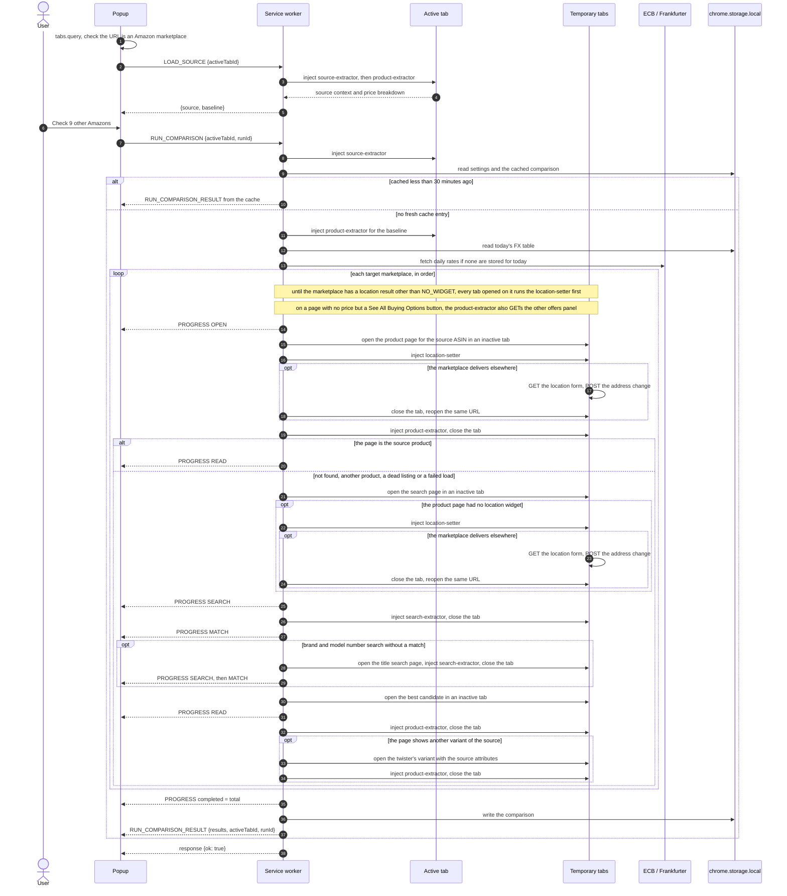

# Architecture

Across Amazon is a Manifest V3 extension with four parts:

- **Popup** (`popup.html`, `src/popup`): a React app that shows one comparison for the active tab.
- **Background service worker** (`src/background`): runs comparisons, owns the temporary tabs, fetches exchange rates and caches results.
- **Content scripts** (`src/content`): three small extractors and the delivery location setter, injected on demand into Amazon pages with `chrome.scripting.executeScript`. None is declared in the manifest, so nothing runs on a page until a comparison asks for it.
- **Options page** (`options.html`, `src/options`): the full settings form.

The manifest asks for `scripting` and `storage`, plus host permissions for the ten Amazon domains and the two exchange rate hosts, `www.ecb.europa.eu` and `api.frankfurter.dev`. Without `tabs`, Chrome gives the popup the active tab's URL only on those Amazon hosts, so any other tab reads as not on Amazon. Setting a store's delivery location and reading its other sellers' offers need no other permission: those requests go from the store's own page to its own origin.

## How a comparison runs

### 1. The popup opens

The popup asks `chrome.tabs.query` for the active tab. If the URL's host is not one of the ten marketplace domains, it shows "Open an Amazon product page" and sends nothing to the background.

Otherwise it sends `LOAD_SOURCE` with the tab id. The background (`loadSource` in `orchestrator.ts`) injects `content/source-extractor.js` into the tab to read the **source context**: marketplace, ASIN, title, brand (from the brand row of the product overview, else the store byline), variation tokens from the selected colour, size, style and pack options, the destination country as an ISO 3166-1 alpha-2 code and the text of Amazon's "Deliver to" box, and the product image. The destination comes from fields Amazon renders on the page for its own scripts, in this order: the `vas-base-vm` state block's `countryCode`, the hidden `input#countryCode`, then the inline `$Nav.declare('config.customerCountryCode', …)`; a `null` there means unknown. Without them it falls back to the country named in the "Deliver to" box, then to the marketplace's own country when the box shows a town and a postcode in that marketplace's format. Otherwise the destination is left unset; it never defaults to the marketplace's country. The United Kingdom is `GB`. It then injects `content/product-extractor.js` into the same tab to read the **baseline**: item price, shipping and import fees on the page you are on. `LOAD_SOURCE` returns the raw baseline without fetching exchange rates, so the idle view appears quickly. If the source context cannot be read, the response carries an `error` and the popup shows the not-on-Amazon notice. If only the price cannot be read, the popup shows the product without one.

### 2. The user starts a run

Clicking the button creates a **run id** (`crypto.randomUUID()`) and sends `RUN_COMPARISON {activeTabId, runId}`. The popup switches to the running view straight away.

The background (`runComparison`) then:

1. **Registers a run token** for the tab. A token holds a `cancelled` flag, the ids of the temporary tabs the run opened and the delivery location result of each target marketplace. Starting a run for a tab cancels any previous token for that tab.
2. **Extracts the source context** again on the active tab and **loads the settings** (`settings:v1`). The target marketplaces are the enabled ones minus the source marketplace.
3. **Checks the cache.** The key (`cmp:<hash>`) is built from a cache version, the ASIN, variation tokens, source marketplace, destination country, the source page's "Deliver to" text and target marketplaces. The text keeps two addresses apart that resolve to the same country code, such as a town and postcode and the bare country. A record younger than 30 minutes is returned as the result immediately, with no progress messages and no tabs. The version changes when extraction or matching changes, so a result cached by an earlier build is never shown. It is 6 since target marketplaces are set to the source destination before they are read.
4. **Extracts the baseline** on the active tab. Missing shipping or import fees on the page you are on count as zero, except the import fees of a baseline quoted from [another seller's offer](#other-sellers-offers), which stay unread so the popup says the page's total leaves them out.
5. **Fetches the FX table** (`fx-service.ts`). The table is stored per UTC day as `fx:YYYY-MM-DD`. When today's table is missing, the worker fetches the ECB daily reference rates XML and falls back to the Frankfurter API (`api.frankfurter.dev/v1/latest`). Both rate hosts are host permissions: the ECB feed sends no CORS headers, and listing Frankfurter keeps the fallback independent of its CORS headers. If both fail the run ends with an error.
6. **Checks each target marketplace in turn**, one at a time:
   - **OPEN**: opens `https://<domain>/dp/<source ASIN>` in an inactive tab, waits up to 15 seconds for it to finish loading, sets the marketplace's [delivery location](#delivery-location), reads the page with `content/product-extractor.js` and closes it. The page is the source product when its own ASIN field or canonical link names the source ASIN, it has a product title, and that title shares at least one word with the source title. The marketplace is then **matched by ASIN**: it skips to READ with a match score of 1 and the note "Matched by ASIN". A not-found page, a redirect to another ASIN, an unrelated title, a load timeout, a closed tab or a script failure falls back to a **search**. So does a **dead listing**, a page for the source ASIN with no price that says the item is currently unavailable or out of stock (in English, German, French, Italian, Spanish or Japanese) or has no availability notice and no way to buy, as amazon.de and amazon.fr still serve the black WH-1000XM5; that search skips result cards for the source ASIN. A page with no price because the item cannot be shipped to the address is still matched by ASIN: the listing is live, and a search would find no better one on that marketplace. When the source title carries a distinctive model number (at least five characters with two letters and two digits that is not a measurement such as `128GB`, for example `WH-1000XM5`), the worker first opens `https://<domain>/s?k=<brand model>` in another inactive tab and waits for it the same way: amazon.co.jp lists no WH-1000XM5 for the whole English title but lists it first for "Sony WH-1000XM5". When that search yields no confident match, or the title has no such model number, it searches `https://<domain>/s?k=<title brand variant>`.
   - **SEARCH** (search fallback only, once per query): injects `content/search-extractor.js`, reads up to eight organic result cards (ASIN, title, brand, price and product link, in both the current and the older card layout), and closes the tab. Sponsored cards and cards without a `/dp/` or `/gp/product/` link are skipped.
   - **MATCH** (search fallback only): scores every candidate against the source (`shared/matching.ts`). A candidate with the source ASIN and at least one title word in common scores 1. Any other candidate is scored on title token similarity 45%, brand 25% and variation 30%. Variation compares pack, size and colour tokens from the source's selected options and both titles. Brand only counts when the source page has one, and variation only when both the source and the candidate's title name one (search cards often leave the colour out of the title); the remaining weights are scaled up to 100%. A candidate without a brand gets 0.75 for brand when its title names the source brand. A candidate whose brand equals the source brand and whose title carries the source's distinctive model number scores its title at least 0.7, so a localized or reworded listing (amazon.it's "WH-1000XM5 Premium Bluetooth Headphones with Noise Cancelling", title similarity 0.545) reaches 0.8071; the lift is withheld from bundles (" & ", " + ", "bundle"), from candidates naming another colour, pack or size, and from candidates with a second model number. A candidate whose model numbers all differ from the source title's is capped at 0.5. Two model numbers are the same when they are equal once hyphens are dropped (`WH1000XM5` and `WH-1000XM5`) or when one is a bare segment of the other (`1000XM5`), so `WF-1000XM5` earbuds do not pass for `WH-1000XM5` headphones. The best candidate must score at least 0.78, otherwise the marketplace becomes `NO_CONFIDENT_MATCH`. The best candidate's product page is opened in another inactive tab.
   - **READ**: for a search match, injects `content/product-extractor.js` with the source destination country, reads the cost stack and closes the tab. A match by ASIN uses the page already read during OPEN. A search match then gets a **variant check**: the values the page's twister has selected are compared with the source's colour, pack and size tokens, each kind on its own. When a kind conflicts (a silver listing for a black source), the worker opens the variant the page's twister offers with the source's attributes, once, and reads that page instead, adding the note "Switched to the Black variant". When the twister offers no such variant, or that page still conflicts, the marketplace becomes `NO_CONFIDENT_MATCH` with the variant it found. When that page cannot be read (timeout, closed tab, script failure), the worker keeps the listing it matched, with the notes "Could not read the Black variant: <reason>" and "Quoted listing is another variant: Silver". The result is `DESTINATION_MISMATCH` when the page quotes another country than the source destination (its delivery location could not be set, or Amazon ignored the change), or when the location could not be set and the page shows no readable destination; `UNAVAILABLE` when the item price or the shipping is missing (including a page that exists but shows no price for the destination, whose notes relay Amazon's availability message), and `OK` otherwise. A page with no price that offers "See All Buying Options" is quoted from [another seller's offer](#other-sellers-offers) when one delivers there, so it is `OK` with that offer's item and delivery. The item price is the buy box's price to pay, else the centre column's: when its offscreen copy is blank, as it is in the centre column on every current layout, it is assembled from the visible currency symbol, whole and fraction. Per-unit, list (RRP), struck-through and twister prices are never read as the item price, and neither are other products' prices: the fallbacks that take any price to pay or any centred price look only inside the product block (`#ppd`), and the sponsored card above it, the recommendation carousels below it and the similar items of an out-of-stock box are always skipped, so a dead listing that suggests priced sponsored items stays unavailable. Shipping comes from amazon.com's AmazonGlobal details table, else its AmazonGlobal line ("No Import Charges & $17.88 Shipping to Switzerland"), else the price attribute of the primary delivery message (amazon.com's message text names only the date and the destination, and the fastest-delivery option is never quoted), else the text of the delivery blocks. Import fees come from the same table, then the same line, then the import blocks; "No Import Charges" or "No Import Fees Deposit" means zero import fees. When the line quotes one sum for both ("$76.32 Shipping & Import Charges to Switzerland"), the shipping is the delivery message's price and the import fees are the rest of the sum; when no delivery price in the same currency and at or below the sum is shown, the sum is the shipping and the import fees stay unread. A page that prices the item and the delivery but shows no import fees is `OK` with a total of item plus shipping and the note "Import fees not displayed for destination": only amazon.com shows import charges for an address abroad, in its AmazonGlobal details. The page's destination is read from the same page fields as the source's, first; without them it is the country named in its "Deliver to" box, or named in full in its delivery message or that message's destination attribute; two-letter codes count only in the box, so Spanish "de" or English "it" in a delivery message is not read as a country. When the box shows a town and a postcode in the marketplace's own format instead of a country, as Amazon does for an address at home (five digits for the US, Mexico and the EU stores, `A1A 1A1` for Canada, UK outward and inward codes, `123-4567` for Japan, four digits for Australia), the destination is the marketplace's own country (`GB` for amazon.co.uk), unless the source page's "Deliver to" box shows the same postcode. A page matches when its destination is unreadable, when the source destination is unknown, or when both codes are equal. Its confidence is 80% match score plus 20% parse confidence, so a fully read match by ASIN has confidence 1. Its notes start with "Matched by ASIN", or "Matched by search" and the confidence label, then the location step's note if any ("Delivery location set to Switzerland", "Delivery location not set: <reason>" or "Delivery location not offered: <code>"), and its link is `https://<domain>/dp/<matched ASIN>`. The worker waits up to 25 seconds for the product extractor's result. An extractor that returns nothing, or any other thrown error after the lookup (timeout, closed tab, script failure), becomes `PARSE_FAILED` for that marketplace only. Every temporary tab is closed as soon as its read ends, whether it succeeded or failed, so a failed marketplace leaves no tab open while the next one runs.

   Entering each phase sends `RUN_COMPARISON_PROGRESS` with `completed`, `total`, `currentMarketplace`, `phase`, the **partial ranking** of the results so far, and the FX table. The popup uses these to draw the dial and the chips. A marketplace matched by ASIN reports OPEN then READ; a search fallback reports OPEN, SEARCH, MATCH and READ, with SEARCH and MATCH a second time when it also searches by title.
7. **Normalizes** each `OK` result. A quote from [other sellers' offers](#other-sellers-offers) first becomes the offer with the lowest delivered total in the comparison currency. Then the delivered total (item + shipping + import fees when the page shows them, in the page's currency, or Amazon's displayed total when it is higher) is converted to the comparison currency. When the charges are in different currencies, as for another seller's offer on amazon.co.uk with the item in pounds and the delivery to Switzerland in francs, each charge is converted on its own and the results are added; a displayed total, converted the same way, is kept when it is at least that sum, as for a total in one currency. A result whose total cannot be converted becomes `UNAVAILABLE` with the note "Missing FX conversion path to <currency>".
8. Sends a final progress message with `completed = total`, **writes the cache record**, and returns the payload: source, baseline, sorted results, `generatedAt`, FX table, `activeTabId` and `runId`.
9. **Closes any temporary tabs** that are still open, whatever the outcome.

The service worker (`service-worker.ts`) sends the payload as `RUN_COMPARISON_RESULT` and only then answers the original `RUN_COMPARISON` message with `{ok: true}`. If the popup gets no `ok` answer (the background could not be reached), it ends the run with "Could not reach the background service".

The popup ranks and labels results itself (`src/popup/view-model.ts`). It converts every delivered total to the display currency from the result's own breakdown and the FX table, so changing the display currency never needs a new run. A result whose charges are in different currencies is converted charge by charge, and its total in the store's own currency (the ranked row and the breakdown sheet) converts the other charges into the item's currency; without an FX table that total shows "—".

### Delivery location

The goal is the marketplace that delivers the item to the user at the lowest price, so every target marketplace must quote the source destination. Every tab a run opens on a target marketplace goes through `readTargetTab` in `orchestrator.ts`. On the first such tab of each marketplace, when the source destination is known, it writes `__ACROSS_AMAZON_LOCATION_REQUEST__` (`{marketplace, countryCode}`), injects `content/location-setter.js` and awaits `__ACROSS_AMAZON_LOCATION_RESULT__` for up to 20 seconds. The setter (`src/content/location-setter.ts`) works from the page's own origin, with the store's cookies:

1. It reads the page's destination with the same fields as the extractors. When it is already the destination, the result is `ALREADY_SET` and nothing is sent.
2. It reads the location widget, `#nav-global-location-data-modal-action`, whose `data-a-modal` JSON holds the form URL and the page token (`ajaxHeaders["anti-csrftoken-a2z"]`, else `#glowValidationToken`). A page without it (a not-found page, a robot check) gives `NO_WIDGET`, which is not recorded, so the marketplace's next tab tries again. A form URL on another origin than the page's is refused without a request (`FAILED`, "Amazon's location form is on another origin"), so the page token is only ever sent to the store itself.
3. A destination equal to the marketplace's own country is refused without a request (`FAILED`, "a postcode is needed for an address in the store's own country"): Amazon sets an address at home by postcode only.
4. It GETs the form URL (`/portal-migration/hz/glow/get-rendered-address-selections?…&storeContext=<ctx>&actionSource=desktop-modal`) with the page token in `anti-csrftoken-a2z`. Without that header Amazon answers a sign-in fragment with no token. The POST token is the `CSRF_TOKEN` of the form's `P.declare("GLUXWidget", …)` script, with its key and value in single or double quotes and the value's escapes resolved; a value with an escape it cannot resolve counts as no token. The page token and the form's `meta` token are not accepted. The form is parsed in an inert document, so its scripts never run.
5. When the form has a country select (`#GLUXCountryList`) that does not list the destination, the result is `NOT_OFFERED` and nothing is posted (amazon.com.au offers few countries). A form without a select (amazon.ca, amazon.com.mx) is posted to and its answer trusted.
6. It POSTs `/portal-migration/hz/glow/address-change?actionSource=glow` as JSON with the form token: `locationType: "COUNTRY"`, `district` and `countryCode` set to the destination, `storeContext` and `pageType` from the form URL, `deviceType: "web"` and `actionSource: "glow"`. Amazon answers a rejected token with 200 and an empty body, so only `successful: 1` with `address.countryCode` equal to the destination counts as `SET`. Anything else is `FAILED` with the reason.

After `SET` the worker closes that tab and opens the same URL in a fresh one, which carries the new location in the store's session; it does not reload the tab, so no stale `complete` status can be read. The result is kept in the run token, so each marketplace is handled once per run and never retried after a failure. A timeout, or an injection whose result cannot be read, is `FAILED` and the read goes on in the same tab. Stop closes the tab, which ends the wait with the cancellation error.

**Side effects.** Target marketplaces are left delivering to the source destination; the previous location is never restored, and the user's own tabs on those stores show the new one after a reload. Only a country is set, never an address. The source marketplace is never a target, so its location is never changed. Two runs from sources with different destinations at once would switch each other's targets, and a page that then shows the other destination is reported as `DESTINATION_MISMATCH`, not priced; only a page whose destination cannot be read at all would be priced unchecked.

### Other sellers' offers

A product page can show no price for the destination because its featured offer does not deliver there while other sellers' offers do. For LEGO 76417 with an address abroad, amazon.de, amazon.co.uk, amazon.fr, amazon.it, amazon.es and amazon.com.mx show a "See All Buying Options" button (`#buybox-see-all-buying-choices`) instead of a price; amazon.com, amazon.co.jp, amazon.ca and amazon.com.au show no such button. The injected product extractor runs `extractProductDataWithOffers` in `product-extractor.ts`. The worker asks it for other offers (`readOtherOffers`) on every product read of a run, the run's baseline included, but not for `LOAD_SOURCE`, so opening the popup only reads the page you are on. When asked, and when the page gives no item price, quotes the source destination, does not say the item is currently unavailable and has that button, it:

1. Builds the request Amazon's All Offers Display sends when its "New" filter is ticked, from the data attributes of the page's `#all-offers-display-params` input, on the page's own origin: `GET /gp/product/ajax/aodAjaxMain/ref=aod_f_new?asin=<ASIN>&m=&qid=&smid=&sourcecustomerorglistid=&sourcecustomerorglistitemid=&sr=&pc=dp&pageno=1&filters=%257B%2522all%2522%253Atrue%252C%2522new%2522%253Atrue%257D`, where `filters` is `{"all":true,"new":true}` percent-encoded twice. Without the attributes it uses the page ASIN with every other value empty. `isonlyrenderofferlist=true` is never added: with it Amazon answers a bare fragment without `#aod-offer-list` or the counts.
2. Fetches it with the store's cookies, as a same-origin request (`credentials: "same-origin"`). The whole read, every page included, has one 15-second deadline: page 1 gets all of it, each later page only what remains, no further page is asked for when less than 3 seconds remain, and what was read by then is used. The answer is the full panel as an HTML fragment, holding only new offers, with their number in `#aod-total-offer-count`; it is parsed in an inert document. While that total is above the offers read (or, when the panel gives no total, while its "See more" link `#aod-show-more-offers` is not hidden with `aod-hide` and its "End of results" `#aod-end-of-results` is not shown), it asks for `pageno=2`, then 3, with the same request, until it has read the total, a page adds no offer it has not seen (same seller, item and delivery), a page cannot be read, or three pages are in. Amazon's page size is unverified: no listing with more than one page of offers that deliver abroad was found.
3. Reads every offer of `#aod-offer-list` with `src/content/other-offers.ts`; the pinned block above the list (`#aod-pinned-offer`) is never read: it holds the featured offer, the one that does not deliver to the destination when the page shows no price (the captures read "No featured offers available"). Per offer: the condition (every offer of the filtered answer is new, and the check stays as a guard: new when Amazon's condition code, the offer's `amzn1.bot.NEW` content id, says so, whatever language the panel is in, or when the heading reads "New", "Neu", "Nuevo", "Neuf", "Nuovo" or "新品"), the price to pay (assembled from its visible symbol, whole and fraction, as its offscreen copy is blank, else the amount in its accessibility label; a list price is never read), the delivery price (the delivery message's `data-csa-c-delivery-price` attribute, else whichever comes first in the text of the primary or the no-promise delivery message, an amount or a "FREE" marker for zero, so a free-delivery threshold such as "FREE delivery on orders over €29" is never read as the charge), the seller and the dispatcher.
4. Lists every new offer of the pages read with both an item price and a delivery price (or free delivery) in `otherOffers`, in Amazon's own order ("sorted by price + delivery: low to high"), and quotes the first of them. The content script has no exchange rates, and an offer's item and delivery can be in different currencies, as on amazon.co.uk.
5. During a run, `normalizeResult` in the worker replaces that quote with the listed offer whose delivered total in the comparison currency is the lowest (`withCheapestOtherOffer` in `src/shared/comparison.ts`), keeping Amazon's order on a tie. Offers it cannot convert are left out of the choice; when none converts, Amazon's first offer stays. The goal is the cheapest delivered price, which Amazon's own sort does not promise. In the amazon.co.uk fixture, whose delivery prices are scrubbed, the second offer (£699.00 + CHF 40.86) is the cheaper one delivered, so a run quotes it.

A quote replaces the page's breakdown with that item and delivery, leaves the import fees unread, marks the listing available and sets `otherSeller` on the result: the seller, the dispatcher, whether Amazon dispatches it, how many new offers the panel lists (`offerCount`), how many were read (`readCount`) and whether that is all of them (`readComplete`), and how many of those read deliver (`deliveringNewCount`). After a short read, the popup's seller line counts only the offers read ("among the first 10 read of the 12 Amazon lists"). After the worker's choice, `otherSeller` describes the chosen offer and gains `comparedCount`, the number of listed offers whose delivered total could be converted, and the list of offers is dropped before the result reaches the popup or the cache. The popup claims "cheapest" only over the offers it compared. Its notes are "Quoted another seller's offer" and "Import fees not displayed for destination" instead of the page's missing price and shipping and Amazon's availability message. The orchestrator copies `otherSeller` and `otherOffers` into the `ComparisonResult` of an `OK` quote. For the baseline, `extractBaseline` returns the list beside the result, and the run hands it to `normalizeResult` only once the exchange rates are loaded, so the payload of a run that fails before then never carries it. When no offer read is quotable, the note is only "No other seller delivers the item new to the destination" when the read is complete and every new offer read either has a price and a delivery price or a delivery message that says it cannot be shipped there (amazon.com.mx's only offer "no se puede enviar"; the notices are the product page's undeliverable notices, shared in `price-reading.ts`). Otherwise it is "Other offers could not be read: …" with the reason: "listed N of M new offers" for a short read, "the panel gave no total" for a short read without a total, "a delivery price could not be read" for a delivery message that gives neither a price nor a reason it cannot ship, and "an item price could not be read". The claim is only made from complete evidence. A failed request, an error status, an answer without an offer list or a page that names no ASIN keeps the page's own reading and adds "Other offers could not be read: <reason>". The 15-second deadline keeps the read well inside the worker's 25-second wait for the extractor's result, which remains a backstop for a script that never settles.

### Cancellation

**Stop checking** sends `CANCEL_COMPARISON {activeTabId}`. The background marks that tab's token as cancelled and closes its temporary tabs at once, including the tab of an ASIN lookup in progress. The run notices at its next phase or when the current marketplace finishes, throws "Comparison cancelled by user", and finishes with an error payload that the popup ignores because it has already returned to idle. A lookup interrupted by Stop never falls back to a search. Each run has its own token, so a run started right after Stop cannot un-cancel the previous one.

### Message correlation

Progress and result messages are broadcast with `chrome.runtime.sendMessage`, so every open extension page receives every message. Each one carries the `activeTabId` and `runId` from the request, and the popup's reducer (`belongsToRun` in `App.tsx`) only accepts a message when:

- its `activeTabId` matches the popup's tab, so a comparison running for another tab or window never shows up, and
- while a run is active, its `runId` matches the run this popup started, so late messages from a stopped or replaced run are dropped.

After a run finishes or is cancelled, further messages for it are ignored. Before the popup has started a run, it accepts progress for its own tab. That is how a reopened popup picks up a run that is still going.

### Why content scripts are IIFE-wrapped

`chrome.scripting.executeScript({ files })` runs a file as a classic script in the page's isolated world, and that world persists between injections. The same tab is injected several times: the source and product extractors run on the active tab for `LOAD_SOURCE` and again for every `RUN_COMPARISON`. A bundled file with top-level `const` or `let` bindings throws `Identifier '…' has already been declared` on the second injection.

The `isolateContentScripts` plugin in `vite.config.ts` wraps every chunk under `content/` in `(() => { … })();` at build time and shifts its source map by one line. It also fails the build if a content chunk imports or exports anything, because a classic script cannot. That is why each extractor keeps its own copy of small helpers such as price parsing, currency detection and the ASIN pattern. A module that only one content script imports is bundled into it: `price-reading.ts` and `other-offers.ts` are part of the product extractor. `tests/unit/build.test.ts` builds the extension and evaluates each extractor twice in the same JSDOM isolated world to prove it.

The background and the extractors exchange data through window properties in the isolated world: the worker writes a request such as `__ACROSS_AMAZON_SEARCH_REQUEST__`, injects the extractor file, then reads and deletes the result property (for example `__ACROSS_AMAZON_SEARCH_CANDIDATES__`). The location setter and the product extractor store a Promise in `__ACROSS_AMAZON_LOCATION_RESULT__` and `__ACROSS_AMAZON_PRODUCT_RESULT__`; `chrome.scripting.executeScript` waits for a Promise a function returns to settle, so the same read returns the settled `LocationResult` or `ProductExtractionResult`.

## Storage

Everything lives in `chrome.storage.local`:

| Key | Contents | Lifetime |
| --- | --- | --- |
| `settings:v1` | Enabled marketplaces, comparison currency (`SOURCE` or a currency code) | Until changed |
| `cmp:<hash>` | Source, baseline, ranked results and FX table of a finished run | Reused for 30 minutes, deleted when read after that |
| `fx:YYYY-MM-DD` | The FX table for a UTC day | Reused for that day |

## Module map

| Path | Responsibility |
| --- | --- |
| `src/background/service-worker.ts` | Message router for `RUN_COMPARISON`, `LOAD_SOURCE` and `CANCEL_COMPARISON`; sends the result message. |
| `src/background/orchestrator.ts` | Run tokens, temporary tabs, script injection, the delivery location step of each target marketplace, the ASIN lookup, the OPEN/SEARCH/MATCH/READ search fallback and its variant check, normalization, caching and progress. |
| `src/background/fx-service.ts` | Daily FX table: storage per UTC day, ECB XML first, Frankfurter as a fallback; exports both endpoint URLs. |
| `src/content/source-extractor.ts` | Reads the source context (ASIN, title, brand, variant, destination, image) from the active product page. |
| `src/content/search-extractor.ts` | Reads organic search result cards in both card layouts (ASIN, title, brand, price, URL) and skips sponsored ones. |
| `src/content/location-setter.ts` | Sets a target marketplace's delivery location to the source destination from its own page: reads the page's country, the location form and its token, and posts the address change. |
| `src/content/product-extractor.ts` | Reads the page ASIN and title, the selected variant and the variants its twister offers, item price, shipping, import fees (including the AmazonGlobal details), displayed total, destination, deliverability and whether the listing is available, undeliverable or unavailable from a product page; when the page shows no price but offers "See All Buying Options", fetches the store's other offers, lists the new ones that deliver and quotes the first. |
| `src/content/other-offers.ts` | Builds the All Offers Display request from the page's parameters, reads each offer of the panel (condition, item price, delivery price, seller, dispatcher) and lists the new offers with both prices, in Amazon's order. |
| `src/content/price-reading.ts` | Price and charge readers the product extractor and the other-offers parser share: localized amounts, currency detection, the price to pay from its visible parts, free-delivery markers and the delivery message's price attribute. |
| `src/shared/types.ts` | Shared data types (`SourceContext`, `ComparisonResult`, payloads, settings). |
| `src/shared/messages.ts` | Message type constants, request shapes and type guards. |
| `src/shared/markets.ts` | The ten marketplaces: domain, currency, locale, flag; search and product URLs; country names through `Intl.DisplayNames`. |
| `src/shared/matching.ts` | ASIN identity, model-number checks, title, brand and variant scoring, the match threshold and the variant check of a matched page. |
| `src/shared/money.ts` | Localized price parsing, delivered totals (converted charge by charge when they are in different currencies), currency conversion and formatting. |
| `src/shared/comparison.ts` | Result ordering: comparable results by normalized total, then the rest; the choice of the other seller's offer that is cheapest delivered in the comparison currency. |
| `src/shared/storage.ts` | Settings and comparison cache access. |
| `src/popup/App.tsx` | Popup state reducer, chrome messaging and run correlation. |
| `src/popup/view-model.ts` | Pure ranking, verdict, deltas and user-facing copy. |
| `src/popup/components/` | Views: top bar, idle, running, done (verdict card, ranked list, issues), detail sheet, settings, footer, toast. |
| `src/options/` | Options page: marketplaces, comparison currency (including CAD, MXN and AUD), a non-affiliation statement, explicit save. |
| `vite.config.ts` | Multi-entry build (popup, options, service worker, four content scripts) and the IIFE plugin. |
| `manifest.json` | Copied into `dist/` by `pnpm build`. |
| `public/icons/` | Extension icons at 16, 32, 48 and 128 pixels, copied into `dist/icons/` by the build. |

See [Testing](testing.md) for how each layer is tested.
