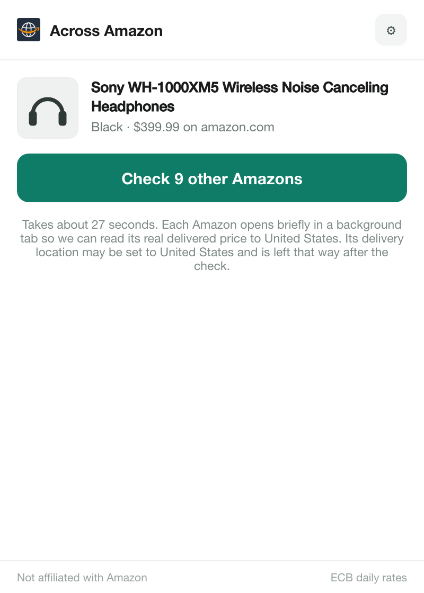
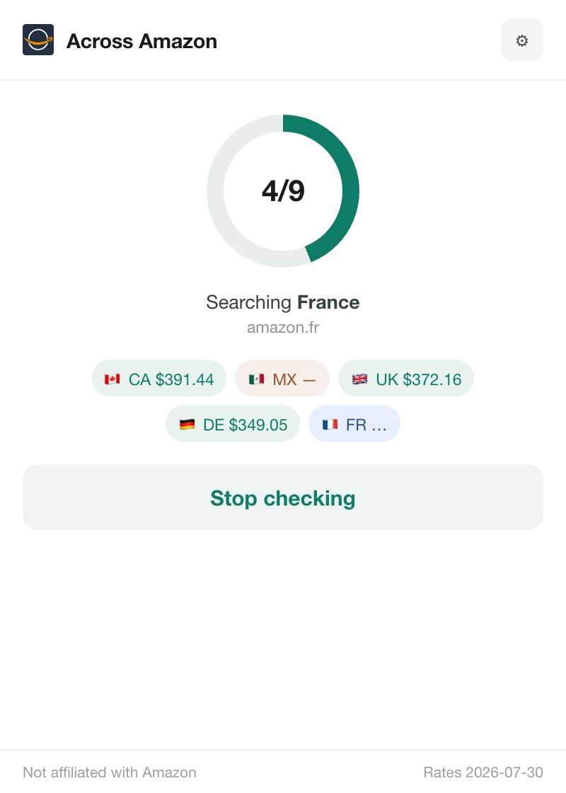
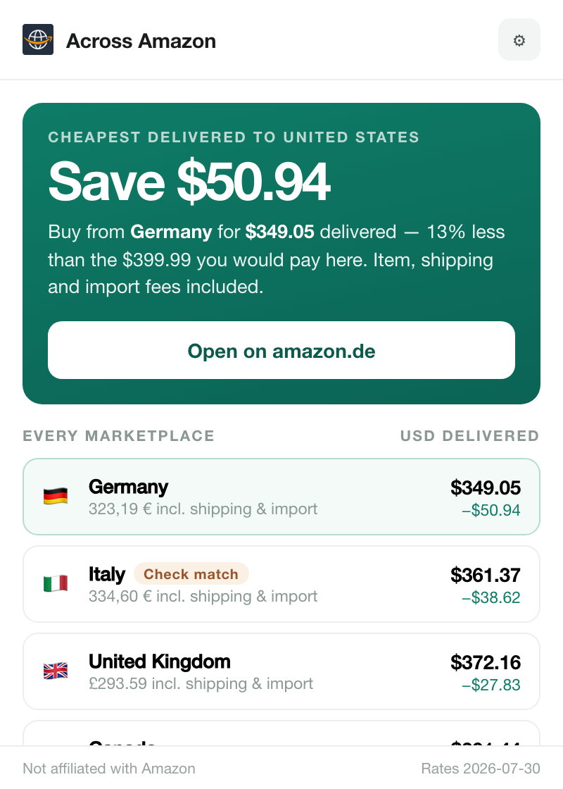
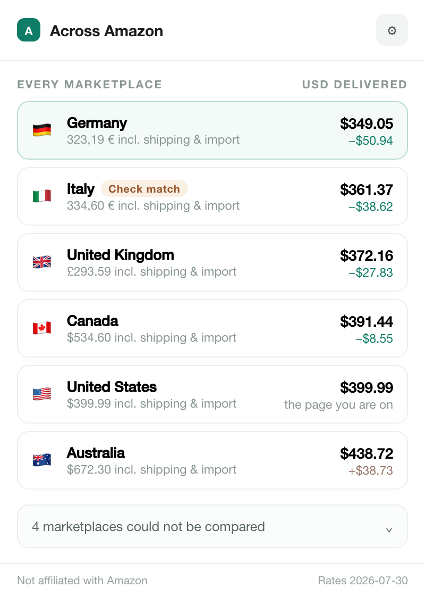
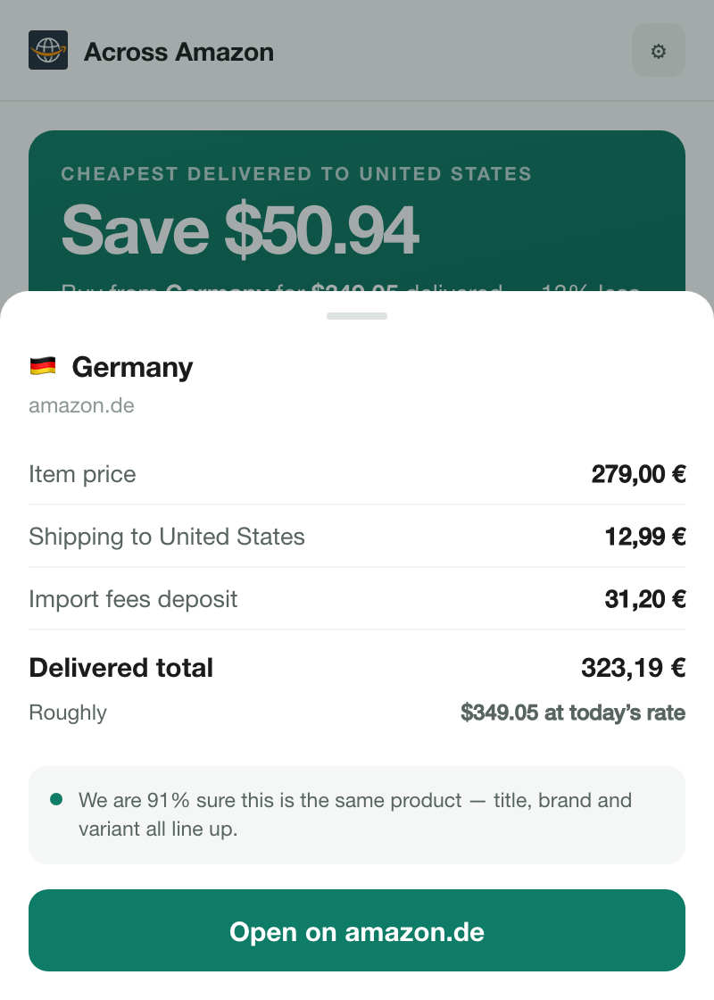
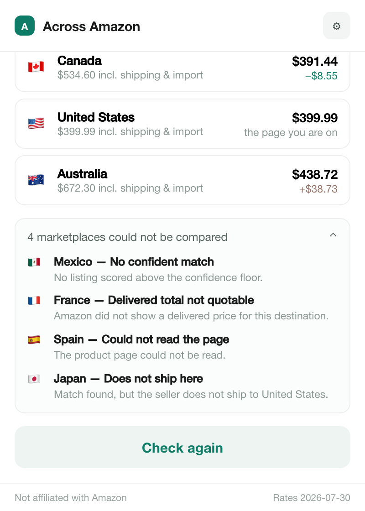
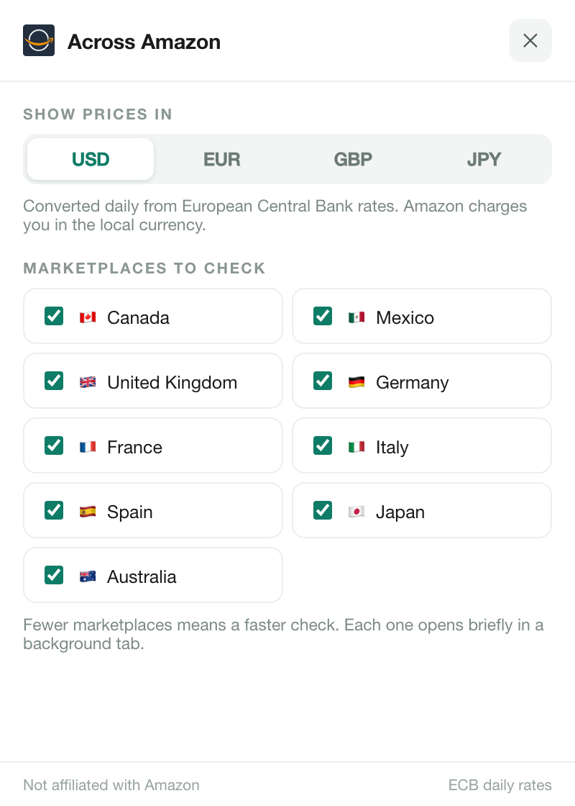
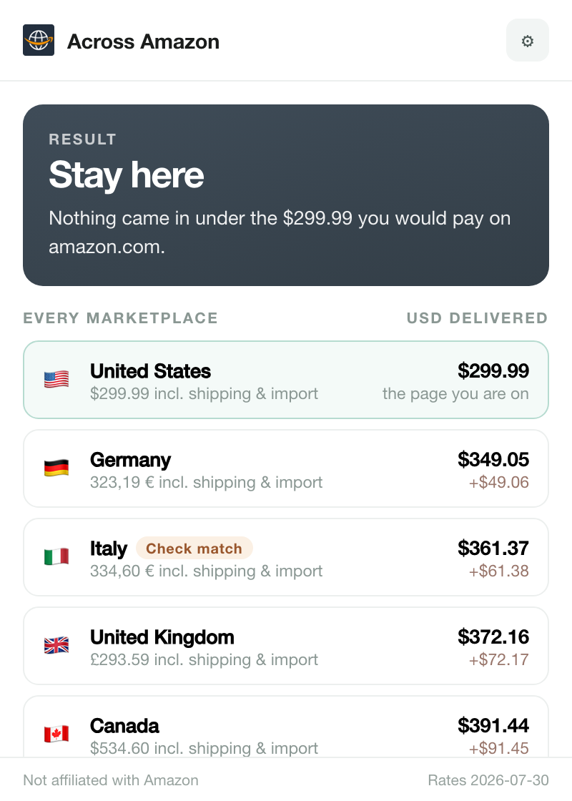
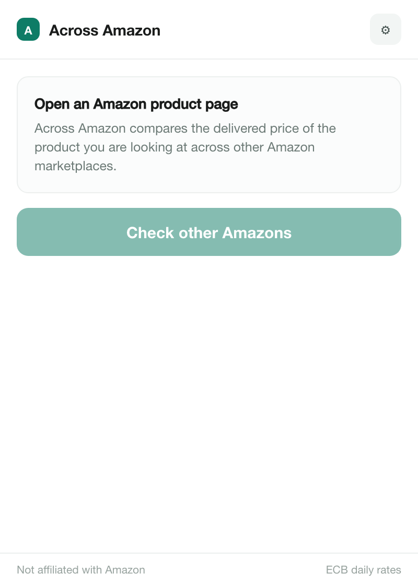

# Using the popup

Across Amazon answers one question about the product page you are on: is it cheaper, delivered to your address, from another Amazon marketplace? This guide walks through every state of the popup.

> [!NOTE]
> The screenshots use illustrative fixture data from [`tests/fixtures/popup.ts`](../tests/fixtures/popup.ts): a Sony WH-1000XM5 bought from amazon.com for delivery to the United States, with exchange rates dated 2026-07-30. The prices, fees, rates and confidence scores are made up for the example. They are not real Amazon prices. Regenerate the images with `pnpm docs:screenshots` (see [Testing](testing.md#docs-screenshots)).

## Where it works

Open the popup on a product page on any of the ten supported marketplaces:

| Code | Marketplace | Domain | Currency |
| --- | --- | --- | --- |
| US | United States | amazon.com | USD |
| CA | Canada | amazon.ca | CAD |
| MX | Mexico | amazon.com.mx | MXN |
| UK | United Kingdom | amazon.co.uk | GBP |
| DE | Germany | amazon.de | EUR |
| FR | France | amazon.fr | EUR |
| IT | Italy | amazon.it | EUR |
| ES | Spain | amazon.es | EUR |
| JP | Japan | amazon.co.jp | JPY |
| AU | Australia | amazon.com.au | AUD |

A check covers every marketplace switched on in [Settings](#6-settings) except the one you are on, so by default it covers the other nine. Nothing runs until you click the button.

## 1. Idle

When the popup opens it reads the page you are on and shows:

- the product title and image
- the variant it detected (here "Black") and the item price on the current marketplace
- one button, **Check 9 other Amazons**. The number is how many marketplaces will be checked.
- a time estimate of about 3 seconds per marketplace

While the page is still being read, the popup shows "Reading this page…" in place of the product card.

The footer reads "ECB daily rates" until a check has loaded exchange rates. After that it shows the date of the rates in use.

## 2. Running

Each marketplace is searched and read in background tabs that open without taking focus and close as soon as they have been read. The popup shows:

- **The dial**: how many marketplaces are finished out of the total (4/9 here).
- **The current step** for the marketplace in progress: *Opening tab*, *Searching*, *Matching product* or *Reading cost stack*, followed by its domain.
- **A chip per finished marketplace**, in the order they were checked. A green chip shows the delivered total in your display currency. A chip with "—" means that marketplace could not be compared. The [issues list](#5-issues) explains why once the check is done. The blue chip with "…" is the marketplace being checked now.

**Stop checking** cancels the run and closes any background tabs it opened. Closing the popup does not stop a check: it finishes in the background and its result is [cached](#what-the-numbers-mean). Reopen the popup on the same tab to follow its progress.

## 3. Verdict

The card at the top gives the answer:

- **Cheapest delivered to United States** names the destination the prices were quoted for: the country in Amazon's "Deliver to" box on the page you are on, or the marketplace's own country when the page does not show one.
- **Save $50.94** is the difference between the cheapest delivered total ($349.05 from Germany) and the delivered total on the page you are on ($399.99).
- **13% less** is that saving as a share of what you would pay here.
- **Open on amazon.de** opens that product page in a new tab. You review it and buy there, on Amazon. The extension never adds to cart or checks out.

### The ranked list

Below the card, **Every marketplace** ranks every marketplace that returned a delivered price, cheapest first. The page you are on is part of the list, so you can see where it ranks.

Each row shows:

- **Left**: the marketplace and its delivered total in its own currency, formatted the way that marketplace formats prices (for example `323,19 €` on amazon.de).
- **Right, bold**: the same delivered total converted to your display currency (the column header shows which, here USD).
- **Right, below**: the delta against the page you are on. A green `−$50.94` is that much cheaper. A brown `+$38.73` is that much more expensive. The row for the current page reads "the page you are on".

The cheapest row is highlighted. Click any row to open its [breakdown sheet](#4-breakdown-sheet).

### What "Check match" means

Every listing in the list passed the product-matching threshold, but matches are scored, not certain. Each result carries a confidence that combines how closely the listing's title, brand and variant match your product with how cleanly its product page could be read. When that confidence is below 90%, the row (and the verdict card, if it is the cheapest) shows a **Check match** pill. In the example Italy scored 76% because its listing title does not state the colour.

Open the listing and confirm it is the same product, variant and condition before you buy. Listings that score below the matching threshold are never ranked. They appear under [issues](#5-issues) as "No confident match".

## 4. Breakdown sheet

Clicking a row slides up its breakdown, in the marketplace's own currency:

| Line | Meaning |
| --- | --- |
| Item price | The price on the product page. |
| Shipping to United States | Shipping to your destination, or "Free". |
| Import fees deposit | The import fees Amazon quotes for your destination, or "—" when there are none. |
| Delivered total | Item + shipping + import fees. |
| Roughly | The delivered total converted to your display currency at the day's rate. |

The note under the lines says how sure the match is, for example "We are 91% sure this is the same product — title, brand and variant all line up." A low-confidence match gets an amber note instead. **Open on amazon.de** opens the listing. The sheet for the page you are on shows the product and variant and a **Close** button. Press Escape or click outside the sheet to close it.

## 5. Issues

Marketplaces that could not be compared are folded under **N marketplaces could not be compared** at the bottom of the results. Expand it to see why:

| Status | What happened |
| --- | --- |
| No confident match | No search result scored above the matching threshold, so nothing is compared rather than risking the wrong product. |
| Delivered total not quotable | Amazon did not show a complete delivered price (item, shipping and import fees) for your destination. |
| Could not read the page | The product page could not be read, or the tab failed to load in time. |
| Does not ship here | A match was found, but the seller does not ship to your destination. |

**Check again** at the bottom starts a new check.

## 6. Settings

The gear in the top bar opens settings. The ✕ closes them and takes you back to where you were. Changes are saved as soon as you make them. They are the same settings as on the extension's options page.

- **Show prices in** chooses the display currency. The first choice is the currency of the marketplace you are on, and it follows that marketplace when you shop on another one. The others are fixed choices among USD, EUR, GBP and JPY. A currency picked on the options page (which also offers CAD, MXN and AUD) shows up here too.
- **Marketplaces to check** turns individual marketplaces on or off. The marketplace you are on is not listed because it is always the reference. Fewer marketplaces make the check faster.

## When nothing is cheaper

When no marketplace beats the page you are on, the card turns slate and reads **Stay here**. In this example the amazon.com price is $299.99. The page you are on is the highlighted top row, and every other row shows how much more it would cost.

The card has two other answers:

- **The cheapest delivered total, with no saving.** This shows when the price on the page you are on could not be read. The popup still names the cheapest marketplace but has nothing to compare it with.
- **No delivered price.** None of the marketplaces could quote a delivered price to your destination.

If the check itself fails (for example the exchange rates could not be loaded, or the extension's background service did not answer), the card reads **Couldn't compare** with the reason.

## When you are not on an Amazon product page

On any other site, or on an Amazon page that is not a product page (search results, the cart), the popup asks you to open an Amazon product page and the button stays disabled.

## What the numbers mean

- **Delivered total** = item price + shipping to your destination + import fees deposit, as quoted on the Amazon product page, in that marketplace's currency. If Amazon displays a total that is higher than that sum, the displayed total is used.
- **Conversion**: totals are converted to your display currency with the European Central Bank daily reference rates (with [Frankfurter](https://frankfurter.dev/) as a fallback when the ECB feed is unavailable). Rates are fetched at most once a day, and the footer shows their date. Amazon charges you in the marketplace's own currency, so your card or bank's rate decides what you actually pay.
- **Delta**: the converted delivered total minus the converted delivered total of the page you are on. The page you are on is always the reference.
- **Saving percentage**: the saving divided by the delivered total on the page you are on.
- **Confidence**: how sure the extension is that a listing is the same product. See [What "Check match" means](#what-check-match-means).
- **30-minute cache**: a finished check is stored in the extension's local storage, keyed by product, variant, destination and the set of marketplaces checked. **Check again** within 30 minutes returns that result instantly instead of opening the background tabs again. After 30 minutes a fresh check runs.
